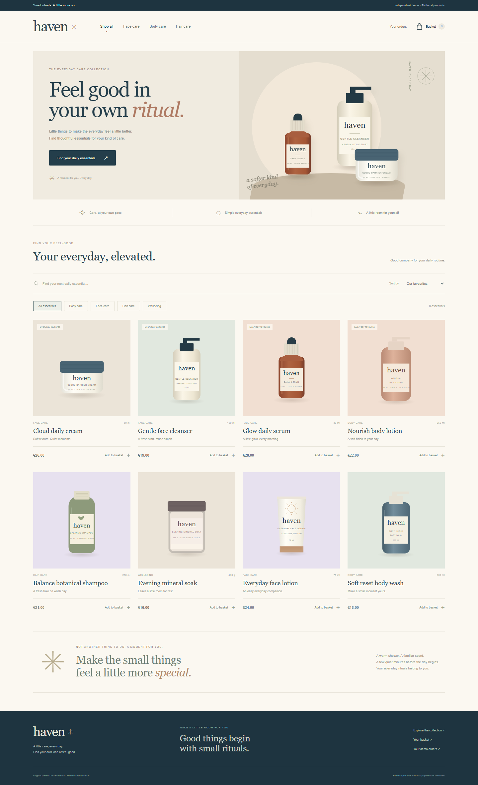

# Haven

**Independent project reconstruction, newly built in November 2026.** Haven is an original Laravel and Livewire personal-care marketplace demo. It uses fictional products, original illustrations, and simulated orders. This repository contains newly authored portfolio code, not an employer's application or historical source code.

Browse a small collection, narrow it by category or keyword, and place a payment-free demo order. Prices come from the server, stock is checked when an order is placed, and each browser session has its own order history.



## Project context and evidence

| Context | What is supported |
| --- | --- |
| Resume period | The supplied resume reports employment at LET'S DO YOUR PLAN from August 2023 to March 2026. This is employment context, not Haven's development period. |
| Company-project connection | [Son Banh's public portfolio](https://sonbt.dev/) names Humasana among his work at LDYP. This is another developer's account of his own work. |
| Public product | [Humasana](https://www.humasana.com/fr/) operates a wellness and personal-care marketplace. Its general commerce domain inspired this reconstruction. |
| Individual assignment | The resume subject's participation in Humasana, responsibilities, and actual project dates have not been verified. |
| This repository | Created in November 2026. Commit dates record actual new development; no historical contribution dates are asserted. |

Haven's interface, sample catalog, and implementation were created independently. It does not reproduce company source code, branding, customer data, or proprietary workflows. The public portfolio describes Laravel, PostgreSQL, vector search, and AI features for Humasana; **Haven instead implements a smaller Livewire/SQLite commerce demo with keyword search**, without AI recommendations or an external API requirement.

## Features

- Livewire catalog with keyword search, category filters, sorting, and shareable URL state.
- Product detail pages with original SVG packaging illustrations and stock availability.
- Session basket with add, update, remove, quantity validation, and totals calculated in integer EUR cents.
- Simulated checkout with fictional contact details; use an email ending in `.test`, such as `alex@example.test`.
- Transactional stock updates: a failed line rolls back the whole order, and stale baskets cannot oversell the available stock.
- Idempotent checkout: resubmitting a completed checkout returns the original order without decrementing stock again.
- Order item snapshots and order history limited to the browser session that placed the order.
- Responsive layouts, accessible form labels, keyboard focus, and empty/error states.

No payment is collected, no email is sent, and nothing is shipped. Session access is a demonstration mechanism; this app does not include customer accounts or a production payment integration.

## Run locally

Requirements: PHP 8.5 recommended (8.4.1 minimum for the locked dependencies), Composer 2, and the SQLite/PDO SQLite, mbstring, intl, DOM/XML, and fileinfo extensions. No Node build is needed.

```sh
git clone https://github.com/hi676sweet/wellness-marketplace-reconstruction.git
cd wellness-marketplace-reconstruction
composer run setup
composer run dev
```

Open `http://127.0.0.1:8064`. Setup creates a local environment file, generates an application key, creates the SQLite database, and migrates/seeds eight fictional products. Dependencies are pinned by `composer.lock`.

Checkout accepts fictional details such as `Alex Demo`, `alex@example.test`, `12 Example Lane`, `Demo City`, and `00000`. Orders persist locally; access to them follows the current browser session. Losing that session also loses access to its order history.

To erase local demo orders and restore the sample inventory:

```sh
php artisan migrate:fresh --seed
```

## Validate

```sh
composer validate --strict
php artisan test --compact
vendor/bin/pint --test
php artisan view:cache
```

The feature tests cover catalog behavior, basket validation, server-owned prices, stock rollback, repeated checkout, and order ownership. GitHub Actions runs the automated checks on pushes and pull requests. Independent desktop/mobile browser acceptance checks are also run during development.

## Implementation

Laravel 13 and Livewire 4 serve Blade templates and a small original CSS/SVG asset set. SQLite stores the catalog and order snapshots; encrypted database sessions isolate shoppers. Basket writes use session locking, while checkout uses a database transaction, conditional stock decrements, and a unique checkout key. Application secrets, local databases, generated caches, and dependencies are excluded from the repository.

MIT licensed; see [LICENSE](LICENSE).
